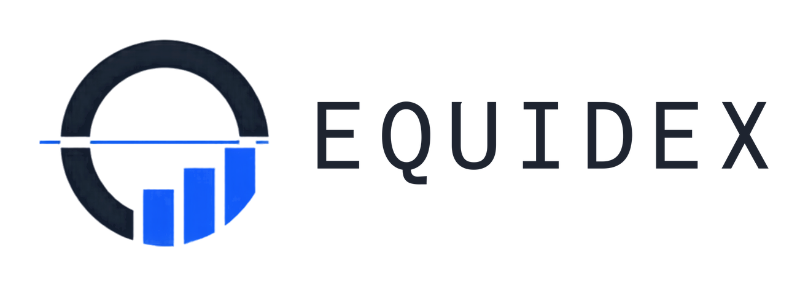

<div align="center">

<picture>
  <source media="(prefers-color-scheme: dark)" srcset="equidex-inconsolata-dark.png">
  
</picture>

**A keyboard-driven equity research app for US and Indian markets.**

Quotes, fundamentals, filings, options, screening, portfolio tracking and paper trading in one workspace.<br>
No API keys. No account. Your portfolio stays on your device.

**Strictly for personal use.**


[Features](#features) · [Getting started](#getting-started) · [Keyboard shortcuts](#keyboard-shortcuts) · [Data sources](#data-sources) · [Disclaimer](#disclaimer)

</div>

---

## About

EQUIDEX brings the research you would otherwise do across a dozen websites into one fast desktop window. Type a ticker to open a company, then move between its financials, analyst views, ownership, deals, options and history without leaving the keyboard.

A single **US / IN** switch scopes the whole app to one market. Everything is fetched from free, keyless public sources by a small local server on your own machine, and missing figures are shown as `—` rather than estimated.

## Features

| Area | What you get |
|---|---|
| **Markets and Dashboard** | Quotes, watchlist, intraday charts, top movers and sector heatmaps |
| **Portfolio** | Track your holdings and transactions, saved locally on your device |
| **News** | Market and company headlines, linked to the original publishers |
| **Financials** | Ratios plus full income statement, balance sheet and cash flow |
| **Analyst Ratings and Dividends** | Consensus ratings, price targets and payout history |
| **Holdings and Institutions** | Institutional owners and 13F filers |
| **Relationships and M&A** | Parent and subsidiary structure from filings, and deal activity |
| **Relative Value** | Compare a company against its industry peers |
| **Calendar and Economy** | IPO and earnings calendars, plus US and India economic indicators |
| **Foreign Exchange and Correlation** | Spot rates, a cross-rate matrix and a correlation matrix of your watchlist |
| **Options Chain** | US and NSE option chains with prices, Greeks and return metrics |
| **Prediction** | A transparent read of trend, trailing returns and historical analogs |
| **Time Machine** | Pick a past date and see the chart and what the model said at the time |
| **Screener** | Filter the market by fundamentals |
| **Paper Trading** | Simulated USD and INR books marked to real market prices |

## Getting started

### Install on Windows

1. Download [`EQUIDEX-Setup.exe`](EQUIDEX-Setup.exe).
2. Run it and follow the wizard. No administrator rights are needed.
3. Open EQUIDEX from the Start Menu or Desktop shortcut.

The app needs an internet connection and the Microsoft Edge WebView2 runtime, which comes with Windows 11 and current Windows 10. The installer is not code-signed, so Windows may show a warning the first time you run it.

### Run from source

```bash
pip install pypdf
python serve.py 8777
```

Then open <http://localhost:8777/Equidex.html>. The app itself uses only the Python standard library; `pypdf` is needed for the features that read PDF filings.

### Build the desktop app

```bash
pip install pyinstaller pywebview pypdf
python -m PyInstaller --noconfirm --clean EQUIDEX.spec
python -m PyInstaller --noconfirm --clean EQUIDEX-Setup.spec
```

The results are `dist/EQUIDEX.exe` and `dist/EQUIDEX-Setup.exe`. Build the app first, because the installer embeds it. Releases are built with Python 3.12.

### Build for Android

See [`android/README.md`](android/README.md). The Android app wraps the separate mobile interface and runs the same local server on the device. It supports Android 7 and later on ARM64.

## Keyboard shortcuts

| Key | Action |
|---|---|
| Ticker, then `Enter` | Open a company |
| `F2` `F3` `F4` `F5` `F6` | Equity, Gainers, Losers, Volume, Top movers |
| `F7` | Indices |
| `Tab` | Dashboard |
| `Esc` | Back to Markets |
| `Del` twice | Remove the selected watchlist row |

You can also type a command to jump to a tool:

| Command | Tool | Command | Tool |
|---|---|---|---|
| `F` | Financials | `M` | Mergers and deals |
| `A` | Analyst ratings | `O` | Option chain |
| `D` | Dividends | `SCREEN` | Screener |
| `R` | Relative value | `PRED` | Prediction |
| `H` | Holdings | `FX` | Foreign exchange |
| `REL` | Relationships | `CORREL` | Correlation |
| `N` | News | `CHART` | Chart |

## How it works

```text
Equidex.html (desktop) / equidex-mobile.html (mobile)
        │  same-origin requests
        ▼
serve.py  (local server on 127.0.0.1)
        │  fetches and normalises data
        ▼
Public data sources
```

| Path | Purpose |
|---|---|
| `Equidex.html` | Desktop interface: all tabs, charts and tools |
| `equidex-mobile.html` | Separate mobile interface |
| `serve.py` | Local web server and data proxy |
| `app.py` | Native Windows window around the server |
| `setup_wizard.py` | Windows installer wizard |
| `order_book.py`, `rpo.py`, `executive_oge.py` | Order book, remaining obligations and executive disclosure lookups |
| `android/` | Android project |
| `EQUIDEX.spec`, `EQUIDEX-Setup.spec` | Build definitions for the app and installer |

## Data sources

| Source | Used for |
|---|---|
| Yahoo Finance | Quotes, charts, fundamentals, options, analyst data and movers |
| SEC EDGAR | US filings, financials, insider trades, 13F holdings and subsidiaries |
| NSE India | Indian corporate announcements, insider trades, deals and option chains |
| Screener.in | Indian financial statements and quarterly EPS history |
| Upstox and MCX | Instrument lists and commodity futures |
| Google News | Market headlines |
| Nasdaq | IPO and earnings calendars |
| US BLS and World Bank | Economic indicators |
| Wikipedia | S&P 500 constituent changes |
| OpenFIGI | CUSIP to ticker mapping |

Figures may be delayed, incomplete or inaccurate. These sources can change or block access at any time, and each has its own terms of use. EQUIDEX is not affiliated with or endorsed by any of them. See [`SETUP.md`](SETUP.md) for details.

## Disclaimer

EQUIDEX is a research and information tool only. Nothing it shows is investment, financial, legal or tax advice, or a recommendation to buy or sell any security. Verify every figure against the primary source and consult a licensed professional before making a decision. The software is provided as is, without warranty of any kind.

## License

EQUIDEX is **strictly for personal, non-commercial use**. It is not open-source software. You may not sell it, use it commercially, offer it as a service or redistribute it without written permission. See [`LICENSE`](LICENSE), [`TERMS.md`](TERMS.md) and the third-party notices in [`THIRD-PARTY-LICENSES.txt`](THIRD-PARTY-LICENSES.txt) and [`SETUP.md`](SETUP.md).
